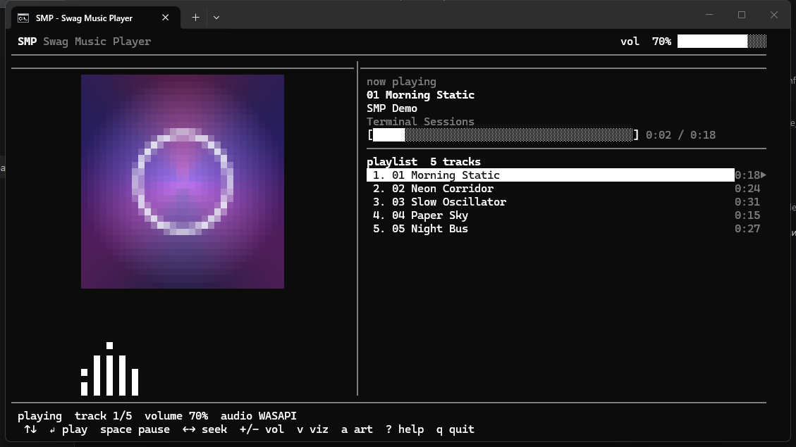
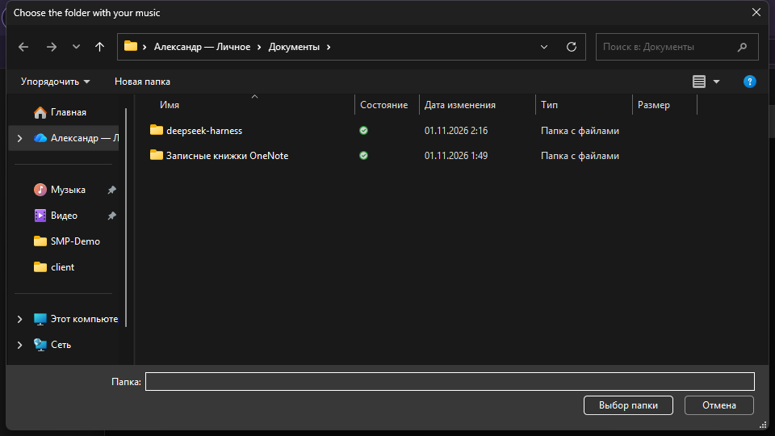
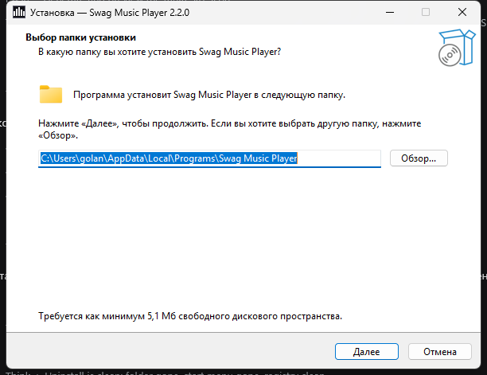

# SMP-Swag Music Player

Terminal music player written entirely in C (C17). Plays WAV, MP3, FLAC and
Ogg Vorbis files and shows the album cover, a seven band spectrum analyser and
the playlist in a single terminal window.



## Features

- WAV, MP3, FLAC, Ogg Vorbis
- 64-bit build; file offsets, sizes and sample positions are 64-bit
- audio output through miniaudio: WASAPI, ALSA, PulseAudio, CoreAudio
- cover art rendered with half-block characters or as ASCII art
- seven band spectrum analyser (55 Hz – 3348 Hz) with cava-style dynamics
- tags: ID3v2.2/2.3/2.4, ID3v1, RIFF INFO, Vorbis comments
- configuration file for every interface colour and a few options
- no external processes and no runtime dependencies besides the system audio
  library

## Libraries

The player links against the platform audio API only. Everything else is
vendored in `vendor/` and compiled into the binary.

| Library | Version | Used for | License |
| --- | --- | --- | --- |
| [miniaudio](https://github.com/mackron/miniaudio) | 0.11.26 | audio device output, device enumeration and the lock-free ring buffer between the playback thread and the device callback | MIT-0 / public domain |
| [dr_wav](https://github.com/mackron/dr_libs) | 0.14.6 | WAV decoding (PCM, float, A-Law, µ-Law, ADPCM) | public domain |
| [dr_mp3](https://github.com/mackron/dr_libs) | 0.7.4 | MP3 decoding | public domain |
| [dr_flac](https://github.com/mackron/dr_libs) | 0.13.4 | FLAC decoding | public domain |
| [stb_vorbis](https://github.com/nothings/stb) | 1.22 | Ogg Vorbis decoding | public domain / MIT |
| [stb_image](https://github.com/nothings/stb) | 2.30 | PNG, JPEG, BMP and GIF cover decoding | MIT / public domain |

System dependencies:

| Dependency | Platform | Used for |
| --- | --- | --- |
| ALSA (`libasound2`) | Linux | audio output backend used by miniaudio |
| WASAPI | Windows | audio output backend used by miniaudio |
| pthreads | Linux | threads, mutexes, condition variables |
| Win32 threads | Windows | threads, mutexes, condition variables |

## Build

```bash
cmake --preset default
cmake --build --preset default
ctest --preset default
```

Requirements: CMake ≥ 3.20, Ninja, a 64-bit C17 compiler. On Linux also
`pkg-config` and the ALSA headers (`libasound2-dev`).

Windows (MSYS2):

```bash
pacman -S mingw-w64-x86_64-gcc mingw-w64-x86_64-cmake mingw-w64-x86_64-ninja
cmake --preset windows-mingw
cmake --build --preset windows-mingw
```

## Install on Windows

The repository ships **`smpinstall.exe`** in the root. Download the project,
open the folder and run that file — no terminal involved. The wizard installs
the player for the current user without administrator rights, adds a Start
menu entry and, if you keep the checkbox, a desktop shortcut, and registers an
uninstaller in "Apps & features".

The shortcut starts the player, which opens a standard Explorer window — pick
the folder with your music and it starts playing.





The setup is built from `installer/`:

```powershell
winget install --id JRSoftware.InnoSetup -e
powershell -File installer\build.ps1
```

## Usage

```bash
smp ~/Music/Album
smp                                 # Windows: opens the folder chooser
smp --audio null ~/Music/Album     # silent backend
smp --list-devices
smp --init-config
smp --help
```

The album folder is expected to contain the audio files and a cover image
named `cover`, `album`, `folder`, `front` or `art` (`png`, `jpg`, `jpeg`,
`bmp`, `gif`).

| Key | Action |
| --- | --- |
| `↑` / `↓` | move the selection (starts it immediately while playing) |
| `Enter` | play the selected track |
| `Space` | play / pause |
| `←` / `→` | seek 5 seconds |
| `n` / `p` | next / previous track |
| `+` / `-`, `PgUp` / `PgDn` | volume |
| `v` | toggle the visualiser |
| `a` | toggle block / ASCII cover art |
| `r` | reload the library |
| `h`, `?` | help |
| `q`, `Esc` | quit |

## Configuration

`smp --init-config` writes `%APPDATA%\smp\smp.conf` on Windows or
`~/.config/smp/smp.conf` on Linux. Every colour defaults to pure white.

```ini
text = #FFFFFF
accent = #FFFFFF
dim = #FFFFFF
selection_bg = #FFFFFF
playing = #FFFFFF
error = #FFFFFF
progress = #FFFFFF
volume_bar = #FFFFFF
border = #FFFFFF
cover = #FFFFFF
spectrum = #FFFFFF

volume = 70
visualizer = true
cover_mode = blocks      # blocks | ascii
frame_interval_ms = 80   # 16..500
```

`smp --config <path>` reads another file, `smp --no-config` ignores it.

## Layout

```
include/smp/   public headers
src/           portable implementation
src/plat/      terminal and thread backends (POSIX / Win32)
src/audio/     audio output (miniaudio)
vendor/        single-header libraries
tests/         unit tests, run by CTest
docs/          architecture notes and screenshots
```

See [docs/ARCHITECTURE.md](docs/ARCHITECTURE.md) for the threading model and
the module boundaries.

## License

MIT — see [LICENSE](LICENSE). The vendored libraries keep their own licenses,
see [vendor/README.md](vendor/README.md).
